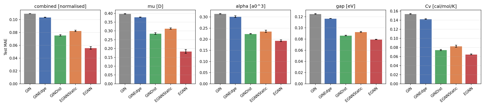
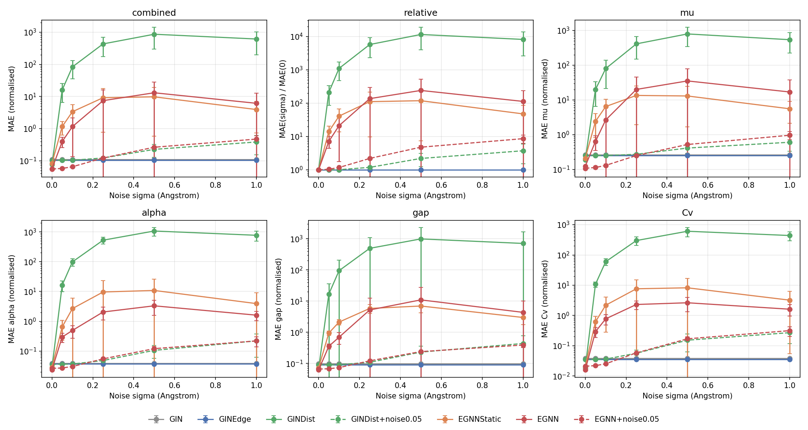
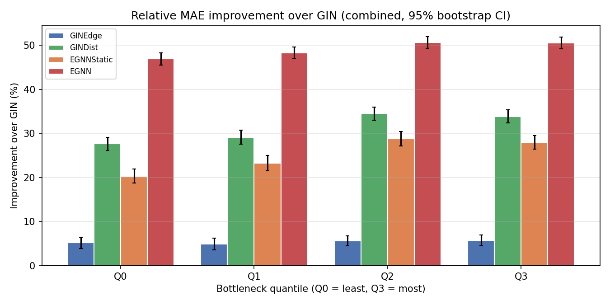

# How much 3D geometry does a GNN need? Geometry-aware message passing on QM9

<p align="center">
  
  <br>
  <em>Image source: <a href="https://www.researchgate.net/publication/377508996_Mode_Collapse_Alleviation_of_Reinforcement_Learning-based_GANs_in_Drug_Design">ResearchGate</a></em>
</p>

This project measures how much each kind of 3D geometric information helps graph
neural networks predict quantum-chemical properties of small molecules (QM9). Five
models form a ladder in which **each step adds exactly one ingredient**, all with the
same training protocol and a matched parameter budget (~200k):

| Model | Sees | Symmetry of the prediction | What the step isolates |
|---|---|---|---|
| **GIN** | atom features + bond graph | trivially invariant (ignores coordinates) | topology-only baseline |
| **GINEdge** | + bond types | trivially invariant | value of bond types |
| **GINDist** | + bond lengths (RBF) | E(3)-invariant | value of distances |
| **EGNNStatic** | same as GINDist, EGNN-style MPNN | E(3)-invariant | architecture, at equal information |
| **EGNN** | + equivariant coordinate updates | E(3)-invariant output, equivariant coordinates | value of equivariance (angular information) |

Beyond the benchmark, two analyses probe *why* geometry helps:

1. **Noise ablation**: perturb coordinates at inference time (no retraining). GIN and
   GINEdge never read coordinates, so their flat curves are a built-in sanity check.
2. **Over-squashing analysis**: Ollivier-Ricci curvature of every bond identifies
   topological bottlenecks; does the gain over GIN grow with bottleneck severity
   *after controlling for molecule size*?

## Targets

Four QM9 properties, trained jointly (multi-task) and chosen to span different physics:

| Property | Symbol | Unit | Extensive / intensive |
|---|---|---|---|
| Dipole moment | `mu` | D | neither (norm of a vector sum) |
| Isotropic polarisability | `alpha` | a0^3 | extensive |
| HOMO-LUMO gap | `gap` | eV | intensive |
| Heat capacity (298 K) | `Cv` | cal/mol/K | extensive |

## Methodology

- **Random split** 110k / 10k / ~10.8k with a fixed seed (QM9 is stored in GDB
  enumeration order, so contiguous slices are not i.i.d.). Every model and seed is
  evaluated on the same molecules.
- Targets standardised with **train-set statistics only**; loss and model selection in
  normalised units, so all four targets weigh equally. Results reported in both
  normalised and physical units.
- **Shared trunk + per-target heads**: sum- and mean-pooled readout, one small MLP per
  property (sum suits extensive, mean intensive properties).
- **Same protocol for all models**: Adam (lr 5e-4), cosine schedule, 300 epochs,
  batch 96, L1 loss, gradient clipping, early stopping (patience 50); the **best
  validation checkpoint** is restored before testing.
- **3 seeds per model**, reported as mean ± std.
- **Tests** check the properties the design relies on: E(3) invariance of every model
  (including reflections), permutation invariance, EGNN coordinate equivariance,
  coordinate-independence of GIN/GINEdge, curvature on hand-computed graphs, split
  integrity, checkpoint restoration.

## Project structure

```
molecular_prediction/
├── main.py                         # CLI entry point (python main.py <command>)
├── Dockerfile                      # GPU training image (CUDA from the locked wheels)
├── scripts/dgx_train.sh            # multi-GPU launcher: models x seeds, then analyses
├── src/molecular_prediction/
│   ├── config.py                   # typed dataclass configuration
│   ├── cli.py                      # commands: params, data, train, compare, noise, curvature, all
│   ├── data/                       # QM9 loading, random split, normalisation, coordinate noise
│   ├── models/                     # GIN family, EGNN / EGNNStatic, shared RBF and readout heads
│   ├── training/                   # trainer, early stopping, metrics, self-contained checkpoints
│   └── experiments/                # comparison, noise ablation, curvature analysis, plots
├── tests/                          # pytest suite (runs on CPU in seconds)
├── results/                        # committed: JSON summaries, per-run metrics, figures
└── outputs/                        # git-ignored: checkpoints, TensorBoard logs, caches
```

## Usage

```bash
uv sync                                   # install (Python 3.11, locked dependencies)
uv run pytest                             # test-suite
uv run python main.py params              # parameter count of every model
uv run python main.py all --smoke --device cpu   # end-to-end check in ~30 s
```

Full pipeline on a single machine:

```bash
uv run python main.py train --device cuda          # 5 models x 3 seeds
uv run python main.py compare                      # results/comparison.json + figures
uv run python main.py noise --device cuda          # results/noise_ablation.json
uv run python main.py curvature --device cuda      # results/curvature_analysis.json
```

Noise-augmented variants are trained by adding the training noise to the run name
(coordinates of every training batch get Gaussian noise of that sigma, in Angstrom;
validation and test stay clean). The analyses include every finished run by default:

```bash
uv run python main.py train --models GINDist+noise0.05 EGNN+noise0.05 --device cuda
```

`train` skips runs whose results already exist, so it can be resumed after an
interruption (`--overwrite` forces retraining). TensorBoard: `tensorboard --logdir outputs/runs`.

### On a multi-GPU server (e.g. NVIDIA DGX) with Docker

Requirements on the host: NVIDIA driver (>= 570 recommended for CUDA 12.8) and the
NVIDIA Container Toolkit.

```bash
git clone <repository-url> && cd molecular_prediction
scripts/dgx_train.sh                                  # auto-detects MIG partitions
GPUS="0 1 2 3" JOBS_PER_GPU=2 scripts/dgx_train.sh    # or choose full GPUs explicitly
```

The script builds the image, downloads QM9 once, trains every (model, seed) pair in
parallel across the available devices, then runs the three analyses. Training state is
saved every epoch, so if the job or session is killed, re-running the same command
skips finished runs and resumes the interrupted one from its last epoch. Containers run as your
user, with `data/`, `outputs/` and `results/` bind-mounted, so everything persists on
the host. Afterwards commit `results/` to bring the numbers and figures back:

```bash
git add results && git commit -m "Add DGX results" && git push
```

## Results

5 models x 3 seeds, 300 epochs each, on one NVIDIA H200 MIG slice (1g.18gb, ~1 h per run).
Test MAE, mean ± std over seeds (combined score in normalised units, targets in physical units):

| Model | Params | Combined | mu [D] | alpha [a0^3] | gap [eV] | Cv [cal/mol/K] |
|---|---|---|---|---|---|---|
| GIN | 200.7k | 0.1094 ± 0.0002 | 0.397 ± 0.002 | 0.314 ± 0.001 | 0.125 ± 0.001 | 0.154 ± 0.001 |
| GINEdge | 198.1k | 0.1036 ± 0.0003 | 0.379 ± 0.001 | 0.302 ± 0.004 | 0.117 ± 0.000 | 0.142 ± 0.001 |
| GINDist | 202.0k | 0.0756 ± 0.0011 | 0.285 ± 0.005 | 0.224 ± 0.002 | 0.086 ± 0.001 | 0.074 ± 0.001 |
| EGNNStatic | 202.7k | 0.0825 ± 0.0011 | 0.314 ± 0.004 | 0.236 ± 0.005 | 0.093 ± 0.001 | 0.083 ± 0.002 |
| **EGNN** | 198.8k | **0.0559 ± 0.0021** | **0.184 ± 0.011** | **0.194 ± 0.004** | **0.079 ± 0.000** | **0.065 ± 0.001** |



**What each step of the ladder shows** (all differences are far larger than the seed-to-seed spread):

- **Bond types help a little** (GIN → GINEdge: −5% combined).
- **Bond lengths help a lot** (GINEdge → GINDist: −27%), most for heat capacity (−48%).
- **With identical information, architecture matters**: EGNNStatic is *worse* than
  GINDist (+9%). GINE's dedicated edge encoder exploits distances better than EGNN's
  concatenation of distance features with atom embeddings.
- **Equivariant coordinate updates give the largest single gain** (EGNNStatic → EGNN:
  −32%). It is graded by target exactly as physics suggests: dipole moment −41%
  (normalised), polarisability −18%, heat capacity −22%, HOMO-LUMO gap −15%. On a bond
  graph, moving coordinates is the only way the model can access bond and dihedral
  angles, and the dipole is the most direction-dependent property.

**Noise ablation.** GIN and GINEdge are exactly flat (sanity check passed). Every
geometric model is extremely sensitive: at sigma = 0.05 A, below thermal vibration
amplitudes, all of them become *worse than the topology-only GIN*, and GINDist's error
grows by two orders of magnitude. Models trained on exact DFT geometries use distances
as a high-precision fingerprint; they are not usable on approximate geometries without
noise-aware training (e.g. denoising / noise augmentation).



**Over-squashing.** Quantiles are balanced (2708 molecules each). The relative gain over
GIN increases mildly with bottleneck severity (EGNN: 47% in Q0 to 51% in Q3; GINDist:
28% to 34%), but the absolute per-molecule gain shows no curvature effect once molecule
size is controlled (EGNN: −0.0033 ± 0.0006 without size, −0.0007 ± 0.0008 with size).
Moreover, with explicit hydrogens every single bond between two sp3 atoms has curvature
exactly −0.5, so 61% of molecules share the minimum value: on the all-atom graph,
curvature mostly measures saturation rather than topological bottlenecks. QM9 molecules
are too small (diameter of a few hops, 4 message-passing layers) for over-squashing to
show. `python main.py curvature --heavy-atoms` repeats the analysis on the hydrogen-free
skeleton.



All numbers: `results/comparison.json`, `results/noise_ablation.json`,
`results/curvature_analysis.json`, per-run metrics and curves in `results/runs/`.

## References

- Satorras, Hoogeboom & Welling (2021). *E(n) Equivariant Graph Neural Networks.* ICML.
- Xu, Hu, Leskovec & Jegelka (2019). *How Powerful are Graph Neural Networks?* ICLR.
- Hu et al. (2020). *Strategies for Pre-training Graph Neural Networks.* ICLR (GINE).
- Schütt et al. (2017). *SchNet: A continuous-filter convolutional neural network for modeling quantum interactions.* NeurIPS (RBF distance expansion).
- Ramakrishnan, Dral, Rupp & von Lilienfeld (2014). *Quantum chemistry structures and properties of 134 kilo molecules.* Scientific Data.
- Alon & Yahav (2021). *On the Bottleneck of Graph Neural Networks and its Practical Implications.* ICLR.
- Topping et al. (2022). *Understanding Over-Squashing and Bottlenecks on Graphs via Curvature.* ICLR.
- Ollivier (2009). *Ricci curvature of Markov chains on metric spaces.* Journal of Functional Analysis.

## Authorship

- Manuel Rodríguez Villegas (manuelrodriguez@alu.comillas.edu)
